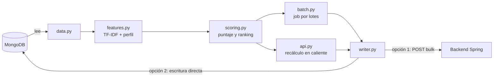

# Recomendador de destinos - Content-Based Filtering

Sistema de recomendación **basado en contenido** (*content-based filtering*) que sugiere destinos de viaje a cada usuario a partir de su historial de reservas y de sus preferencias declaradas. Está pensado como un servicio independiente: un **job por lotes** precalcula las listas y una **API mínima** permite recalcular a un solo usuario en caliente, de modo que la aplicación principal nunca queda esperando a Python.

Desarrollado para el backend de **Royal Airlines**, pero la lógica de puntuación es independiente de la aerolínea y se puede adaptar a cualquier catálogo de ítems con etiquetas ponderadas.

## Tabla de contenidos

- [Características](#características)
- [Cómo funciona](#cómo-funciona)
- [Arquitectura](#arquitectura)
- [Instalación](#instalación)
- [Uso](#uso)
- [Configuración](#configuración)
- [API](#api)
- [Documento que se publica](#documento-que-se-publica)
- [Datos que espera](#datos-que-espera)
- [Evaluación](#evaluación)
- [Pruebas](#pruebas)
- [Estructura del proyecto](#estructura-del-proyecto)
- [Limitaciones conocidas](#limitaciones-conocidas)
- [Próximos pasos](#próximos-pasos)
- [Licencia](#licencia)

## Características

- **Perfil de usuario con memoria**: las reservas recientes pesan más que las antiguas (decaimiento exponencial con vida media configurable).
- **Etiquetas ponderadas con TF-IDF**: una etiqueta común a casi todos los destinos distingue poco; una rara distingue mucho.
- **Puntaje multicomponente**: afinidad, presupuesto, temporada y oferta, más un multiplicador de encaje según la compañía de viaje.
- **Explicable**: cada recomendación incluye sus componentes, las etiquetas que coincidieron y códigos de razón (`TAG_MATCH`, `IN_SEASON`, `PRICE_FITS`…).
- **Arranque en frío resuelto**: usuarios sin historial usan sus intereses declarados; sin ninguna señal reciben el ranking de populares.
- **Respeta restricciones del usuario**: los destinos vetados nunca se recomiendan y los ya visitados se penalizan.
- **Solo recomienda lo reservable**: descarta destinos sin vuelos activos por venir.
- **Dos modos de publicación**: escritura directa en MongoDB o envío a un endpoint interno del backend.
- **Evaluación offline** con *leave-last-out* frente a una línea base de populares.

## Cómo funciona

### Puntaje

```
score = (0.5·afinidad + 0.2·presupuesto + 0.2·temporada + 0.1·oferta) × multiplicador_encaje
```

Los pesos viven en `config.py` y se pueden sobrescribir.

| Componente | Descripción |
|---|---|
| **Afinidad** | Similitud coseno entre el perfil del usuario y el vector de etiquetas del destino (TF-IDF, filas normalizadas). |
| **Presupuesto** | `1` si el precio más barato del destino es igual o menor al habitual del usuario (mediana del precio de los vuelos que ha reservado, o `budgetMax` declarado si no tiene reservas con precio); decrece según cuánto lo excede. Neutro (`0.5`) si no hay referencia. |
| **Temporada** | `1` si el mes de viaje estimado (hoy + 45 días) o alguno de los `preferredMonths` cae en `bestMonths`; `0.5` si es contiguo; `0` si no. |
| **Oferta** | Descuento vigente o qué tan barato está el destino frente a su precio habitual. |
| **Encaje** | `(1 − w) + w · travelerFit[travelCompany]`, con `w = 0.15`. Neutro (`1`) si no hay dato. |

### Perfil del usuario

1. **Historial**: suma de los vectores de los destinos reservados, cada uno ponderado por `0.5^(antigüedad / vida_media)` (vida media por defecto: 365 días).
2. **Intereses declarados**: vector con los intereses que existan en el vocabulario de etiquetas.
3. **Mezcla**: si hay ambos, `0.7·historial + 0.3·intereses`.

### Estrategias

| `strategy` | Cuándo se usa |
|---|---|
| `content` | El usuario tiene reservas confirmadas (con o sin intereses). |
| `preferences` | Sin reservas, pero con intereses declarados. |
| `popular` | Sin señal propia: `0.60·popularidad + 0.25·temporada + 0.10·oferta + 0.05·destacado`. |

La popularidad se calcula por número de reservas; si aún no hay ninguna, por `rating`, pero **solo** en destinos con `ratingCount > 0` (un 3,0 sin opiniones no cuenta).

### Reglas adicionales

- Destinos en `excludedLocationIds` → **nunca** se recomiendan.
- Destinos ya visitados → puntaje × `0.7`.
- Destinos sin vuelos activos futuros → no se recomiendan (si ninguno cumple, se relaja a cualquier vuelo activo).
- Solo cuentan reservas `CONFIRMED`.

## Arquitectura



El recomendador **solo lee** las colecciones del negocio; lo único que escribe es la colección de resultados (`UserRecommendations`).

### Dos formas de publicar

| Configuración | Modo | Qué hace |
|---|---|---|
| `SPRING_INTERNAL_URL` vacío | Escritura directa *(por defecto)* | Escribe en `UserRecommendations`. Se recomienda un usuario de Mongo con solo lectura en el resto y escritura únicamente ahí. |
| `SPRING_INTERNAL_URL=http://…` | Vía backend | Envía las listas a `POST /internal/recommendations/bulk` con `X-API-Key`. El job no escribe en MongoDB (solo lo lee). |

> **Excepción:** el recálculo por usuario (`POST /recomendaciones/{user_id}`) siempre guarda y borra directamente en `UserRecommendations`, aunque `SPRING_INTERNAL_URL` esté definido. Solo el job completo (`batch` y `POST /recalcular`) respeta el modo elegido. Si usas el modo backend, el usuario de Mongo del servicio necesita permiso de escritura en esa colección.

### Recálculo en caliente

El job precalcula (por ejemplo de noche), pero si el usuario edita sus preferencias la lista quedaría desactualizada. El flujo previsto es:

1. El backend invalida el documento del usuario y llama a `POST /recomendaciones/{user_id}` con un timeout corto.
2. Python recalcula solo a ese usuario y guarda el resultado. Si quedó sin señal propia, borra su documento (tanto con `_id` ObjectId como con el string legado) y responde `{"saved": false, "strategy": "popular"}`.
3. Si Python no responde, el backend sirve el documento `__popular__` y el siguiente job repara la lista.

## Instalación

Requiere **Python 3.10+** y acceso a una instancia de MongoDB.

> El código se importa como paquete `recommender`, por lo que la carpeta del proyecto debe llamarse `recommender/` y los comandos se ejecutan desde su carpeta **padre**.

```bash
git clone <URL-DEL-REPO> recommender
cd recommender

python -m venv .venv
source .venv/bin/activate          # Windows: .venv\Scripts\activate
pip install -r requirements-dev.txt

cp .env.example .env               # y ajusta los valores
cd ..                              # vuelve a la carpeta padre
```

## Uso

Ejecuta todo desde la carpeta padre de `recommender/`:

```bash
# Calcular y mostrar sin escribir nada
python -m recommender.batch --dry-run

# Calcular y publicar las listas
python -m recommender.batch

# Opciones útiles
python -m recommender.batch --limit 50            # solo 50 usuarios
python -m recommender.batch --as-of 2026-10-28    # fecha de referencia

# Métricas offline contra «los más populares»
python -m recommender.evaluate

# API de operación
uvicorn recommender.api:app --port 8001
```

## Configuración

Las credenciales salen de variables de entorno (se carga `recommender/.env` automáticamente; una variable ya exportada en la terminal tiene prioridad).

| Variable | Por defecto | Descripción |
|---|---|---|
| `DB_URI` | `mongodb://localhost:27017` | URI de MongoDB. |
| `DB_DATABASE` | `royal_airlines` | Nombre de la base de datos. |
| `INTERNAL_API_KEY` | *(vacía)* | Clave para la API y para `/internal/**` del backend. **Si está vacía, la API responde 503.** |
| `RECS_COLLECTION` | `UserRecommendations` | Colección donde se publican las listas. |
| `PREFS_COLLECTION` | `UserPreferences` | Colección de preferencias declaradas. |
| `COP_USD_RATE` | `4000` | Tasa COP→USD; `budgetMax` está en COP y el puntaje trabaja en USD. |
| `SPRING_INTERNAL_URL` | *(vacía)* | Si se define, publica vía backend en lugar de escribir en MongoDB. |

Los hiperparámetros del modelo están en `Settings` (`config.py`):

| Parámetro | Valor | Significado |
|---|---|---|
| `top_k` | `10` | Destinos por usuario. |
| `weights` | `0.5 / 0.2 / 0.2 / 0.1` | Afinidad / presupuesto / temporada / oferta. |
| `companion_weight` | `0.15` | Influencia del encaje por tipo de compañía. |
| `half_life_days` | `365` | Días en los que una reserva pierde la mitad de su peso. |
| `lead_days` | `45` | Anticipación supuesta del viaje. |
| `repeat_penalty` | `0.7` | Multiplicador para destinos ya visitados. |
| `interest_weight` | `0.3` | Peso de los intereses frente al historial. |
| `model_version` | `content-v1` | Se guarda en cada documento como `modelVersion`. |

## API

Servicio interno pensado para ser llamado por el backend o por un cron. Los endpoints protegidos exigen la cabecera `X-API-Key`.

| Método | Ruta | Descripción |
|---|---|---|
| `GET` | `/health` | Estado del servicio (sin autenticación). |
| `POST` | `/recalcular` | Lanza el job completo en segundo plano (`202`); `409` si ya hay uno en curso. |
| `POST` | `/recomendaciones/{user_id}` | Recalcula y guarda la lista de un solo usuario. |
| `GET` | `/recomendaciones/{user_id}` | Lee lo guardado, útil para depurar. Busca primero el `_id` ObjectId, luego el string legado y por último `__popular__`. |

```bash
curl -X POST http://localhost:8001/recomendaciones/<user_id> \
     -H "X-API-Key: $INTERNAL_API_KEY"
```

## Documento que se publica

Un documento por usuario con señal, más uno especial con `_id: "__popular__"` para el ranking general. El backend busca primero el del usuario y, si no existe, el popular.

**Tipo del `_id`:** si el userID es un hex de 24 caracteres se guarda como `ObjectId`, porque así lo consulta Spring Data; los demás ids (incluido `__popular__`) quedan como string. Al guardar, `writer.py` elimina el documento gemelo con `_id` string que hubiera quedado de versiones anteriores, para que no convivan dos. En modo backend el `_id` viaja como string en el JSON.

```jsonc
{
  "_id": "<userID>",                 // ObjectId si el userID es hex de 24 caracteres; string si no; "__popular__"
  "strategy": "content",             // content | preferences | popular
  "modelVersion": "content-v1",
  "recommendationID": "9f1c…",       // para atribuir reservas a la lista que las originó
  "generatedAt": "2026-10-28T03:00:00",
  "asOf": "2026-10-28T03:00:00",
  "items": [{
    "locationID": "67f5…",
    "iataCode": "MIA",
    "cityName": "Miami",
    "score": 0.809,
    "components": { "affinity": 0.80, "budget": 1.0, "season": 1.0, "offer": 0.07, "fit": 0.9 },
    "matchedTags": ["playa", "compras"],
    "reasons": ["TAG_MATCH", "IN_SEASON", "PRICE_FITS", "COMPANION_FIT"]
  }]
}
```

**Códigos de razón:** `POPULAR`, `TAG_MATCH`, `IN_SEASON`, `COMPANION_FIT`, `PRICE_FITS`, `OFFER`.

## Datos que espera

El recomendador lee estas colecciones de MongoDB (no las modifica):

| Colección | Campos usados |
|---|---|
| `Destinations` | `cityName`, `iataCode`, `tags` (`{etiqueta: peso 0-1}`), `bestMonths` (`[1-12]`), `cheapestPrice`, `rating`, `ratingCount`, `featured`, `travelerFit`, `status` (`HIDDEN` se ignora) |
| `Flights` | `departureLocationID`, `arrivalLocationID`, `ticketPrice`, `departureDate`, `discounted`, `discountPercentage`, `status` |
| `Booking` | `userID`, `bookedFlightID`, `bookingDate`, `totalPrice`, `ticketCount`, `status` (solo `CONFIRMED`) |
| `UserPreferences` *(opcional)* | `_id` (= userID), `interests`, `budgetMax` (COP), `preferredMonths`, `travelCompany` (`solo`/`pareja`/`familia`/`amigos`), `excludedLocationIds` |

Las etiquetas se normalizan (minúsculas, sin acentos, espacios → `_`): `Vida Nocturna` → `vida_nocturna`.

## Evaluación

`python -m recommender.evaluate` aplica *leave-last-out*: para cada usuario con 2 o más reservas a destinos distintos se oculta la última, se construye el perfil con las anteriores y se mide en qué posición del ranking aparece el destino oculto. Se reportan `hit@k`, `ndcg@k` (k = 3, 5, 10) y `MRR`, comparados contra la línea base «los más populares».

La evaluación solo usa el historial y el precio habitual: no incorpora intereses declarados, vetos, meses preferidos ni compañía de viaje, así que mide el modelo sin esas señales.

Si el modelo no supera a esa línea base, el problema suele estar en los datos y no en el algoritmo.

## Pruebas

Las pruebas no necesitan red ni una base real (usan `mongomock`):

```bash
# desde la carpeta padre de recommender/
python -m pytest recommender -q
```

Cubren, entre otras cosas: conversión de presupuesto, vetos, penalización de repetidos, ordenamiento por puntaje mostrado, idempotencia del job, `--dry-run`, autenticación de la API y recálculo de un usuario al vuelo.

## Estructura del proyecto

| Archivo | Responsabilidad |
|---|---|
| `config.py` | Variables de entorno e hiperparámetros del modelo. |
| `data.py` | Lectura de destinos, vuelos, reservas confirmadas y preferencias. |
| `utils.py` | Normalización de etiquetas y fecha UTC. |
| `seasons.py` | Convierte `bestMonths` en conjuntos de meses y puntúa la temporada. |
| `features.py` | Matriz TF-IDF de etiquetas y perfiles de usuario con decaimiento temporal. |
| `scoring.py` | Puntaje, ranking, penalizaciones y explicación de cada recomendación. |
| `batch.py` | Job que recalcula y publica las listas. |
| `writer.py` | Publicación: escritura directa en MongoDB (con `_id` ObjectId y limpieza del gemelo string) o envío al backend. |
| `api.py` | API FastAPI para disparar el cálculo y depurar. |
| `evaluate.py` | Evaluación offline frente a la línea base de populares. |
| `test_pipeline.py` | Pruebas de extremo a extremo. |
